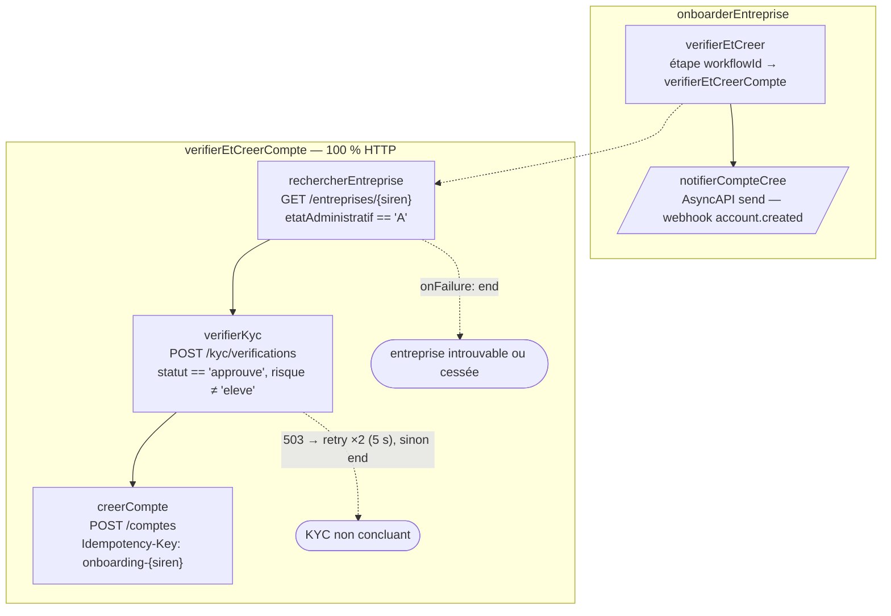

# Onboarding d'une entreprise française (B2B)

Exemple Arazzo 1.1.0 n° 5 de ConnEthics. Une plateforme B2B ouvre un compte à un client professionnel, apporté par un partenaire :

1. **Recherche de l'entreprise par son SIREN** dans un registre. Le stub a la forme d'un registre de type INPI (Registre national des entreprises) ou INSEE SIRENE, dans l'esprit de l'intégration décrite dans `website/INPI_INTEGRATION.md`.
2. **Vérification KYC/KYB** de l'entreprise et de son représentant légal.
3. **Création du compte**, idempotente.
4. **Webhook `account.created`** envoyé au partenaire (étape AsyncAPI `action: send`).

> Aucune vraie clé, aucune vraie URL d'API sensible : tout pointe vers `https://api.example.test` et `hooks.example.test`. Le SIREN `123456789`, la dénomination « EXEMPLE SOCIÉTÉ SAS » et le dirigeant sont **fictifs**. Les credentials amont (OAuth *client credentials*) sont injectés par le runner, jamais écrits dans le workflow.

## Fichiers

| Fichier | Rôle |
|---|---|
| `e2e-onboarding-entreprise-fr.arazzo.yaml` | Workflows `verifierEtCreerCompte` (HTTP seul) et `onboarderEntreprise` (parcours complet) |
| `openapi.yaml` | Stub OpenAPI 3.1 : `GET /entreprises/{siren}`, `POST /kyc/verifications`, `POST /comptes` |
| `asyncapi.yaml` | Stub AsyncAPI 3.0 : webhook HTTPS `account.created` (opération `envoyerCompteCree`, `action: send`) |
| `inputs.json` | Entrées de démonstration |

## Schéma du flux



## Fonctionnalités Arazzo 1.1 illustrées

- **Source `type: asyncapi`** pour un **webhook HTTP** : AsyncAPI 3.0, `protocol: https`, binding `http` `POST`. Les en-têtes du message passent par des paramètres `in: header` (`X-Event-Type`, `X-Event-Id`) ; le payload passe par `requestBody`.
- **`action: send`** (§5.8.5.1) : l'étape se termine dès l'émission, sans accusé modélisé (§5.8.5.3).
- **Composition de workflows** : `onboarderEntreprise` appelle `verifierEtCreerCompte` comme une étape (`workflowId` + `parameters`, sans `in`). Les entrées sont partagées via `components.inputs.demandeOnboarding` (`$ref`). Les sorties du sous-workflow sont lues par `$outputs.<nom>`. La forme équivalente `$workflows.verifierEtCreerCompte.outputs.<nom>` (tableau du §5.9) n'est pas résolue par Respect 2.79 dans ce contexte (« Cannot read "verifierEtCreerCompte" of undefined »).
- **Interpolation 1.1** (§5.9) : `onboarding-{$inputs.siren}` pour la clé d'idempotence et `evt_{$steps.verifierEtCreer.outputs.compteId}` pour l'identifiant d'événement.
- **Descriptions en français**, identifiants ASCII (`identifier-strict` : `[A-Za-z0-9_-]`).

Le découpage en deux workflows a un but pratique : la **partie HTTP reste exécutable de bout en bout** avec Prism + Respect, même si aucun runner open source n'exécute le webhook.

## Exécuter (mock Prism + runner Respect)

```bash
cd app/public/workflows/e2e-onboarding-entreprise-fr

npx -y @redocly/cli@2.79.0 lint e2e-onboarding-entreprise-fr.arazzo.yaml openapi.yaml asyncapi.yaml
npx -y @stoplight/prism-cli@5.16.0 mock -h 127.0.0.1 -p 4014 openapi.yaml &

# Partie HTTP : doit passer (code 0)
npx -y @redocly/cli@2.79.0 respect e2e-onboarding-entreprise-fr.arazzo.yaml -w verifierEtCreerCompte \
  --server onboarding=http://127.0.0.1:4014 --input "$(cat inputs.json)"

# Parcours complet : le sous-workflow passe, le webhook est refusé par Respect (code 1 attendu)
npx -y @redocly/cli@2.79.0 respect e2e-onboarding-entreprise-fr.arazzo.yaml -w onboarderEntreprise \
  --server onboarding=http://127.0.0.1:4014 --input "$(cat inputs.json)"
```

**Ce qu'on attend** : `verifierEtCreerCompte` est vert, avec `compteId: cpt_00a91f`, `niveauRisque: faible` et l'en-tête `idempotency-key: onboarding-123456789`. `onboarderEntreprise` a 3 étapes HTTP vertes, via le sous-workflow, puis `notifierCompteCree` en échec « AsyncAPI not supported ».

## Résultat observé le 16/11/2026

Prism 5.16.0 + Respect 2.79.0 :

```
verifierEtCreerCompte
✓ GET /entreprises/{siren} - step rechercherEntreprise      Request URL: …/entreprises/123456789
✓ POST /kyc/verifications - step verifierKyc
✓ POST /comptes - step creerCompte                          idempotency-key: onboarding-123456789
Workflows: 1 passed · Steps: 3 passed · Checks: 16 passed                     (code 0)

onboarderEntreprise
Running child workflow for the step verifierEtCreer
✓ rechercherEntreprise · ✓ verifierKyc · ✓ creerCompte
✗ notifierCompteCree — Source description webhooks is an AsyncAPI description, which Respect does not support yet.
Steps: 3 passed, 1 failed, 4 total · Checks: 16 passed, 1 failed             (code 1)
```

arazzo-cli 0.9.0 refuse le document au `validate`, à cause de l'étape webhook : « AsyncAPI parameter transport is not supported by this executor » (en-têtes de message), et il ne gère pas `send` de toute façon.

Validation : 0 erreur au schéma officiel 1.1 et aux règles sémantiques §c (`parameters` de l'étape `workflowId` conformes aux `inputs` résolus via `$ref`, `action` réservée à l'étape AsyncAPI). `redocly lint` : 0 erreur, et un seul avertissement, `security-defined`, sur l'opération AsyncAPI.

## Limites

- **Aucun runner testé n'émet de webhook HTTP AsyncAPI** :
  - Respect et arazzo-cli refusent l'étape ;
  - Specmatic a été testé en `send` **Kafka** uniquement (exemple 2).

  Pour tester le webhook, on peut s'appuyer sur un récepteur de test (Microcks en mode test AsyncAPI, ou un serveur HTTP qui valide le payload contre `asyncapi.yaml`). Ce n'est pas exécuté ici.
- La **signature HMAC** du webhook (`X-Signature`) relève de la plateforme d'envoi. Arazzo ne modélise ni secret ni calcul.
- Le stub **n'imite pas l'API INPI réelle**, ni ses chemins ni son authentification. Pour un registre réel, il faut adapter `openapi.yaml`, et garder les identifiants hors du dépôt, dans le coffre du runner.
- **RGPD** : la date de naissance du représentant est une donnée personnelle. En exposition MCP, elle serait masquée dans l'audit, comme dans l'exemple 1.
