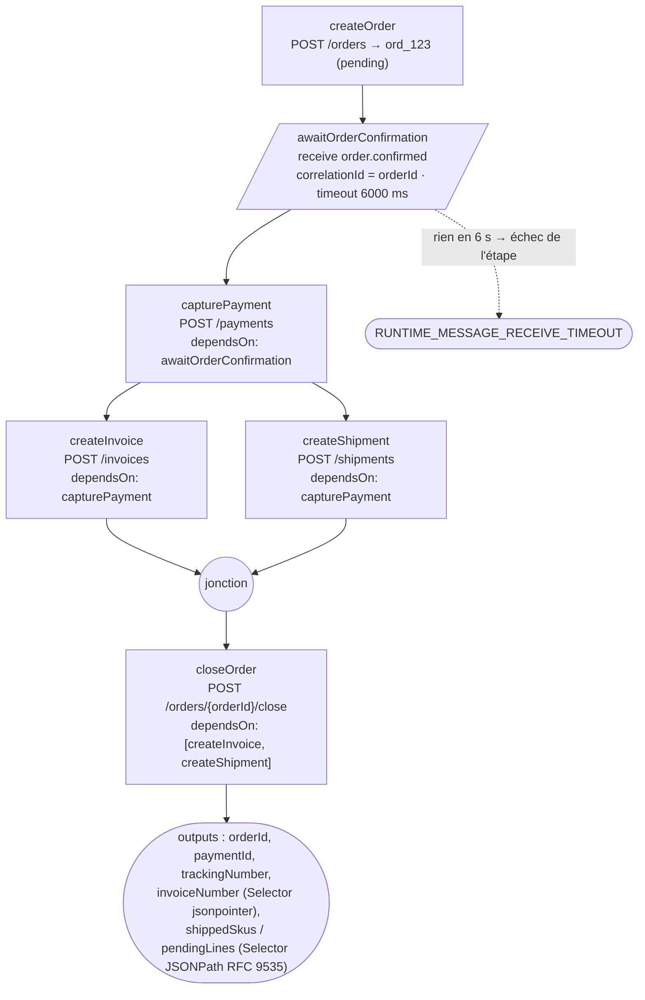

# Order-to-cash hybride HTTP + événements (test E2E)

Exemple Arazzo 1.1.0 n° 3 de ConnEthics. Une commande e-commerce traverse le SI :
1. elle est créée en HTTP, puis **validée de façon asynchrone** par le back-office, qui publie `order.confirmed` sur Kafka ;
2. le workflow **attend cet événement**, corrélé par `orderId`, au plus 6 s ;
3. il capture le paiement, puis émet la facture et crée l'expédition, qui sont indépendantes l'une de l'autre ;
4. il clôture la commande quand **les deux** sont faites.

## Fichiers

| Fichier | Rôle |
|---|---|
| `e2e-order-to-cash.arazzo.yaml` | Workflow `orderToCash` |
| `openapi.yaml` | Stub OpenAPI 3.1 : `POST /orders`, `/payments`, `/invoices`, `/shipments`, `POST /orders/{orderId}/close` |
| `asyncapi.yaml` | Stub AsyncAPI 3.0, vue consommateur : canal `order.confirmed`, opération `receiveOrderConfirmed` (`action: receive`), `correlationId` sur `$message.payload#/orderId` |
| `microcks/order-events.microcks.asyncapi.yaml` | Variante vue producteur, pour que Microcks publie l'événement |
| `tools/fake-backoffice.sh` | Producteur Kafka scripté : il simule le back-office, avec un message « bruit » `ord_999` |
| `inputs.json` | Entrées de démonstration |

## Schéma du flux



## Fonctionnalités Arazzo 1.1 illustrées

1. **Source `type: asyncapi` et étape `action: receive`** (§5.8.5.1, §5.8.5.3) :

   ```yaml
   - stepId: awaitOrderConfirmation
     operationId: $sourceDescriptions.orderEvents.receiveOrderConfirmed
     action: receive
     correlationId: $steps.createOrder.outputs.orderId   # filtre les messages des autres commandes
     timeout: 6000                                       # millisecondes ; au-delà, l'étape échoue
     successCriteria:
       - condition: $message.payload#/status == 'confirmed'
   ```

   L'exemple 2 utilise la forme `channelPath` ; celui-ci la forme `operationId`, la seule que Specmatic résout.
2. **`dependsOn` au niveau de l'étape** (§5.8.5.2) : un **éventail** (facture et expédition dépendent du paiement, pas l'une de l'autre), puis une **jonction** (`closeOrder` attend les deux). Avec `--parallel`, arazzo-cli exécute facture et expédition en parallèle.
3. **Selector Object** (§5.8.13) :
   - en **JSON Pointer** dans une sortie d'étape (`invoiceNumber`, avec `type: jsonpointer`) ;
   - en **JSONPath RFC 9535 avec filtre** dans les sorties de workflow : `shippedSkus` (`$.lines[?@.shipped == true].sku`) et `pendingLines`. L'Expression Type Object versionné `{type: jsonpath, version: rfc9535}` (§5.8.12) y est utilisé.

   ⚠️ **Non évalué par Respect 2.79, faux positif silencieux** : Respect recopie l'objet Selector tel quel. Ici les Selectors ne servent qu'en sortie, jamais dans une requête, donc rien ne casse ; mais les valeurs ne sont justes qu'avec arazzo-cli (JSONPath et JSON Pointer) ou Specmatic (JSON Pointer seulement).

Les critères de succès restent en `simple` + JSON Pointer, seule forme portable (R4).

## Exécuter

### Voie open source : Prism + Kafka + arazzo-cli (`receive` réel)

arazzo-cli (strefethen, MIT) **v0.9.0** est le seul runner open source qui exécute un `receive` Kafka. Il se construit depuis les sources (`cargo build --release -p arazzo-cli --locked`), car les binaires GitHub Releases n'étaient pas accessibles depuis la session.

Deux adaptations sont à faire **sur une copie de travail** :
- arazzo-cli résout les `url` relatives contre `$self`, ce qui est conforme au §5.6.1 : il irait donc chercher les sources sur `arazzo.connethics.com`. On retire `$self`, ou on sert les fichiers à cette URL.
- arazzo-cli n'a pas d'option `--server` : on pointe `servers[0].url` de l'OpenAPI vers Prism.

```bash
cd app/public/workflows/e2e-order-to-cash
npx -y @redocly/cli@2.79.0 lint e2e-order-to-cash.arazzo.yaml openapi.yaml asyncapi.yaml

W=$(mktemp -d) && cp e2e-order-to-cash.arazzo.yaml openapi.yaml asyncapi.yaml "$W"/
sed -i '/^\$self:/d' "$W/e2e-order-to-cash.arazzo.yaml"
sed -i 's#https://api.example.test/commerce#http://127.0.0.1:4012#' "$W/openapi.yaml"

npx -y @stoplight/prism-cli@5.16.0 mock -h 127.0.0.1 -p 4012 openapi.yaml &
docker run -d --name kafka --network host apache/kafka:3.9.1
docker exec kafka /opt/kafka/bin/kafka-topics.sh --bootstrap-server 127.0.0.1:9092 \
  --create --if-not-exists --topic order.confirmed

# Option A — producteur scripté (faux back-office, 20 s) :
tools/fake-backoffice.sh kafka 20 &
arazzo-cli run "$W/e2e-order-to-cash.arazzo.yaml" orderToCash -i customerId=cus_8812 \
  --input-json "lines=$(jq -c .lines inputs.json)" --json
arazzo-cli test "$W/e2e-order-to-cash.arazzo.yaml" --parallel -i customerId=cus_8812 \
  --input-json "lines=$(jq -c .lines inputs.json)" --format junit > junit.xml

# Cas négatif : aucun producteur → timeout attendu après 6 s (code 1)
arazzo-cli run "$W/e2e-order-to-cash.arazzo.yaml" orderToCash -i customerId=cus_8812 \
  --input-json 'lines=[{"sku":"BOOK-42","quantity":2}]' --json
```

**Option B — Microcks 1.16.0** simule le back-office. Microcks publie sur `<titre sans espaces>-<version>-<opération>`, et non sur l'`address`. Le topic est donc `OrderEvents-1.0.0-publishOrderConfirmed`, et l'AsyncAPI consommateur de la copie de travail doit pointer ce topic :

```bash
docker run -d --name microcks --network host quay.io/microcks/microcks-uber:1.16.0-native
docker run -d --name minion --network host -e MICROCKS_HOST_PORT=127.0.0.1:8080 \
  -e ASYNC_PROTOCOLS=,KAFKA -e KAFKA_BOOTSTRAP_SERVER=127.0.0.1:9092 \
  quay.io/microcks/microcks-uber-async-minion:1.16.0     # la virgule initiale est requise
curl -F "file=@microcks/order-events.microcks.asyncapi.yaml" \
  "http://127.0.0.1:8080/api/artifact/upload?mainArtifact=true"
sed -i 's#    address: order.confirmed#    address: OrderEvents-1.0.0-publishOrderConfirmed#' "$W/asyncapi.yaml"
arazzo-cli run "$W/e2e-order-to-cash.arazzo.yaml" orderToCash -i customerId=cus_8812 \
  --input-json "lines=$(jq -c .lines inputs.json)" --json
```

Microcks rejoue un exemple figé (`orderId: ord_123`) : la corrélation ne marche que parce que l'exemple Prism de `POST /orders` renvoie le même identifiant.

### Respect (partie HTTP uniquement)

Respect 2.79 refuse les sources AsyncAPI. `--skip` ignore des **workflows**, pas des étapes : il exécute donc `createOrder`, puis s'arrête sur `awaitOrderConfirmation`.

```bash
npx -y @redocly/cli@2.79.0 respect e2e-order-to-cash.arazzo.yaml \
  --server commerce=http://127.0.0.1:4012 --input "$(cat inputs.json)"   # code 1 attendu
```

### Specmatic (commercial)

Specmatic exécute aussi `receive`, avec corrélation et timeout (essai R4). Il attend en revanche une AsyncAPI **vue système testé**, où l'opération doit porter `action: send`. Recette dans `../ci/arazzo-e2e.yml.example` (job optionnel).

**Ce qu'on attend** : `kind: success` avec `orderId: ord_123`, `paymentId: pay_3021`, `invoiceNumber: FAC-2026-005501`, `trackingNumber: 6A12345678901`, `shippedSkus: [BOOK-42, MUG-07]`. Le message `ord_999` est ignoré grâce au `correlationId`. Sans événement : `RUNTIME_MESSAGE_RECEIVE_TIMEOUT` après 6 s.

## Résultat observé le 16/11/2026

Exécution réelle : Prism 5.16.0, Kafka 3.9.1 (conteneur), arazzo-cli 0.9.0.

Option A (faux back-office, messages `ord_999` puis `ord_123` chaque seconde) :

```json
{ "kind": "success",
  "outputs": { "orderId": "ord_123", "paymentId": "pay_3021", "invoiceNumber": "FAC-2026-005501",
               "trackingNumber": "6A12345678901", "shippedSkus": ["BOOK-42", "MUG-07"],
               "pendingLines": { "sku": "GIFT-CARD-50", "quantity": 1, "shipped": false } } }
```

L'export du run (`--export-run`) donne 6 étapes, toutes en `success`. `awaitOrderConfirmation` a reçu le bon message en 830 ms, avec `warehouseId: wh_lyon_01`, donc celui de `ord_123`.

Cas négatif (aucun message) : `RUNTIME_MESSAGE_RECEIVE_TIMEOUT: no message arrived on topic "order.confirmed" … within the step timeout of 6000 ms`. Code retour 1, en 6,03 s.

Option B (Microcks 1.16.0, topic `OrderEvents-1.0.0-publishOrderConfirmed`) : `kind: success`, mêmes sorties, en 2,66 s. `arazzo-cli test --format junit` : `tests="1" failures="0" errors="0"`, en 0,47 s en séquentiel et 2,98 s avec `--parallel`.

Respect 2.79 : `✓ POST /orders - step createOrder`, puis `✗ awaitOrderConfirmation — Source description orderEvents is an AsyncAPI description, which Respect does not support yet`. Steps : 1 passed, 1 failed (code 1).

Validation : 0 erreur au schéma officiel 1.1 et aux règles sémantiques §c (`dependsOn` résolus et sans cycle, y compris les dépendances implicites `$steps…`, `correlationId` uniquement en `receive`, `timeout` > 0). `redocly lint` : 0 erreur, et un seul avertissement, `security-defined`, sur l'opération AsyncAPI.

## Limites et pièges mesurés

- **arazzo-cli `--parallel`** démarrait le `receive` avant `createOrder` : il ignorait la dépendance implicite créée par `correlationId: $steps.createOrder…`, alors que le §5.8.5.2 l'impose. D'où le `dependsOn: [createOrder]` explicite, redondant mais portable.
- **`security: []` sur une opération AsyncAPI** est refusé par arazzo-cli (« operation-level security … unsupported »). Le stub n'en déclare donc pas, au prix d'un avertissement Redocly.
- **Selector JSONPath qui renvoie un seul nœud** : arazzo-cli rend la valeur seule (`pendingLines` est un objet, pas un tableau). La spec ne précise pas la forme d'une nodelist d'un seul élément.
- **Point de vue `send`/`receive`** : arazzo-cli attend la vue consommateur, Specmatic la vue système testé. Les deux variantes AsyncAPI sont fournies.
- **Respect** n'exécute aucune étape AsyncAPI. Pour cet exemple, il ne sert qu'au lint.
