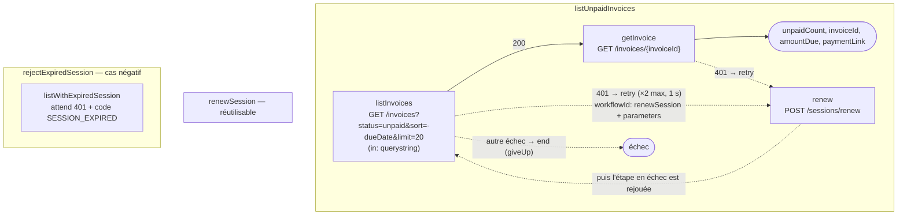

# Renouvellement de session sur 401 (test E2E)

Exemple Arazzo 1.1.0 n° 4 de ConnEthics. Un client consulte ses factures impayées avec un jeton de session. La session peut avoir expiré : l'API répond alors `401` avec le code métier `SESSION_EXPIRED`. Au lieu de coder la relance dans chaque client, le workflow la **déclare** :

- une failure action `type: retry` appelle le workflow réutilisable `renewSession`, avec des `parameters`, puis **rejoue l'étape** ;
- `retryLimit: 2` borne le nombre de tentatives, et `retryAfter: 1` les espace d'une seconde ;
- un **cas négatif explicite** (`rejectExpiredSession`) vérifie le contrat d'erreur sur lequel tout repose.

## Fichiers

| Fichier | Rôle |
|---|---|
| `e2e-session-renewal.arazzo.yaml` | Trois workflows : `renewSession` (réutilisable), `listUnpaidInvoices` (principal), `rejectExpiredSession` (cas négatif) |
| `openapi.yaml` | Stub OpenAPI 3.1 « Billing » : `POST /sessions/renew`, `GET /invoices`, `GET /invoices/{invoiceId}` (sécurité `bearer`) |
| `inputs.json` | Entrées du scénario nominal |

## Schéma du flux



## Fonctionnalités Arazzo 1.1 illustrées

1. **Réutilisation de workflow depuis une failure action** (§5.8.8). La failure action est définie une fois dans `components.failureActions.renewSessionOn401`, puis référencée par les deux étapes :

   ```yaml
   renewSessionOn401:
     name: renewSessionOn401
     type: retry
     workflowId: renewSession
     parameters:              # nouveauté 1.1 : passés aux inputs du workflow, sans `in`
       - name: sessionToken
         value: $inputs.sessionToken
       - name: refreshToken
         value: $inputs.refreshToken
     retryAfter: 1            # secondes
     retryLimit: 2
     criteria:
       - condition: $statusCode == 401
   ```

   Sémantique (§5.8.8.1) : le workflow `renewSession` est exécuté avec ces entrées, puis **l'étape courante est rejouée**, dans la limite de `retryLimit`.
2. **`in: querystring`** (§5.8.6, alignement sur OAS 3.2). La query string entière est **une seule valeur**, avec interpolation : `status=unpaid&sort=-dueDate&limit={$inputs.pageSize}`. Elle ne peut pas coexister avec des paramètres `in: query` sur la même opération.
3. **Cas négatif explicite**. `rejectExpiredSession` réussit quand l'API **refuse** une session expirée (`$statusCode == 401` et `$response.body#/code == 'SESSION_EXPIRED'`). Tester le contrat d'erreur garantit que le déclencheur de la failure action reste stable.

Les critères restent en `simple` + JSON Pointer, seule forme portable entre les runners (R4).

### Modèle de session

La session est **à durée glissante côté serveur** : `POST /sessions/renew` prolonge la session existante, et le même `sessionToken` redevient valide. C'est pourquoi l'étape peut être rejouée **telle quelle**. Si l'API émettait un nouveau jeton, l'étape rejouée devrait le lire (par exemple `Bearer {$workflows.renewSession.outputs.accessToken}`). Arazzo 1.1 n'a pas d'opérateur « valeur par défaut » pour la première tentative, et ce cas se modélise moins bien.

### Note OpenAPI 3.1 et `querystring`

Le stub est en OAS 3.1, qui ne connaît pas `in: querystring`. Il décrit donc `status`, `sort` et `limit` un par un. Le runner envoie la chaîne telle quelle (`?status=unpaid&sort=-dueDate&limit=20`), et Prism la valide paramètre par paramètre. Avec une OpenAPI 3.2, on déclarerait un unique paramètre `in: querystring` avec `content: application/x-www-form-urlencoded`.

## Exécuter (mock Prism + runner Respect)

Versions épinglées (recette R4) : Prism **5.16.0**, Redocly CLI **2.79.0**.

```bash
cd app/public/workflows/e2e-session-renewal

npx -y @redocly/cli@2.79.0 lint e2e-session-renewal.arazzo.yaml openapi.yaml
npx -y @stoplight/prism-cli@5.16.0 mock -h 127.0.0.1 -p 4011 openapi.yaml &

# Scénario A — nominal : les 3 workflows (session valide ; cas négatif avec jeton vide)
npx -y @redocly/cli@2.79.0 respect e2e-session-renewal.arazzo.yaml \
  --server billing=http://127.0.0.1:4011 \
  --input "$(cat inputs.json)" --json-output respect-A.json

# Scénario B — session expirée : démontre retry → renewSession → rejeu (échec ATTENDU, code 1)
! npx -y @redocly/cli@2.79.0 respect e2e-session-renewal.arazzo.yaml -w listUnpaidInvoices \
  --server billing=http://127.0.0.1:4011 \
  --input '{"sessionToken":"","refreshToken":"rt_demo_0123456789","pageSize":20}'
```

Avec Prism, une session « expirée » se simule par un **jeton vide** : `Authorization: Bearer ` produit un `401` (contrôle de sécurité `bearer` de Prism), alors que tout jeton non vide produit un `200`.

**Ce qu'on attend** :
- **A** : 3 workflows verts. `listUnpaidInvoices` renvoie `unpaidCount: 2`, `invoiceId: inv_2026_0042`, `amountDue: 1250` ; `rejectExpiredSession` renvoie `errorCode: SESSION_EXPIRED`.
- **B** : `listInvoices` → 401 → `renewSession` (200) → rejeu, deux fois, puis échec. Avec une **vraie** API à session glissante, le premier rejeu passerait. Le mock étant sans état, il renvoie encore 401 : ce scénario prouve le **mécanisme** (renouvellement exécuté, borne `retryLimit` respectée, délai `retryAfter` appliqué) et sert de garde-fou contre une boucle infinie.

## Résultat observé le 16/11/2026

Scénario A (Prism 5.16.0 + Respect 2.79.0) :

```
✓ POST /sessions/renew - step renew
✓ GET /invoices - step listInvoices
    Request URL: http://127.0.0.1:4011/invoices?status=unpaid&sort=-dueDate&limit=20
✓ GET /invoices/{invoiceId} - step getInvoice
    Request URL: http://127.0.0.1:4011/invoices/inv_2026_0042
✓ GET /invoices - step listWithExpiredSession
Workflows: 3 passed, 3 total
Steps: 4 passed, 4 total
Checks: 20 passed, 20 total
Time: 355ms                                     (code retour 0)
```

Scénario B :

```
✗ GET /invoices - step listInvoices
Running failure action renewSessionOn401 for the step listInvoices
Running workflow e2e-session-renewal.arazzo.yaml / renewSession
✓ POST /sessions/renew - step renew
Retrying step listInvoices (1/2)
✗ GET /invoices - step listInvoices
Running failure action renewSessionOn401 for the step listInvoices
✓ POST /sessions/renew - step renew
Retrying step listInvoices (2/2)
✗ GET /invoices - step listInvoices
Workflows: 1 failed, 1 total
Time: 2263ms                                    (code retour 1 — attendu)
```

Contre-épreuve **arazzo-cli 0.9.0** (copie de travail sans `$self`, serveur pointé vers Prism) :
- A : `listUnpaidInvoices` et `rejectExpiredSession` renvoient `kind: success`, avec les mêmes sorties.
- B : séquence `listInvoices` 401 → `renew` 200 → `listInvoices` 401 → `renew` 200 → `listInvoices` 401, puis l'action `giveUp` (`end`). Code retour 1, en 2,03 s.
- **Divergence entre runners** : une fois les retries épuisés, arazzo-cli passe à l'action suivante de `onFailure` (`giveUp`), alors que Respect arrête l'étape en échec sans l'évaluer. La spec ne tranche pas. Les deux aboutissent à un workflow en échec.

Validation : 0 erreur au schéma officiel 1.1 et aux règles sémantiques §c (cibles `workflowId` des actions, `parameters` sans `in` et conformes aux `inputs` de `renewSession`, `querystring` sans `query` concurrent), `redocly lint` sans erreur ni avertissement.

## Limites

- Le mock est sans état : il ne peut pas « accepter après renouvellement ». Seule une vraie API, ou un mock à scénarios, montre le rejeu réussi.
- `retryAfter` est en **secondes** et `timeout` en **millisecondes** : ne pas confondre.
- La spec ne dit pas si `timeout` couvre une tentative ou le cumul des retries (question ouverte R1 n° 6).
