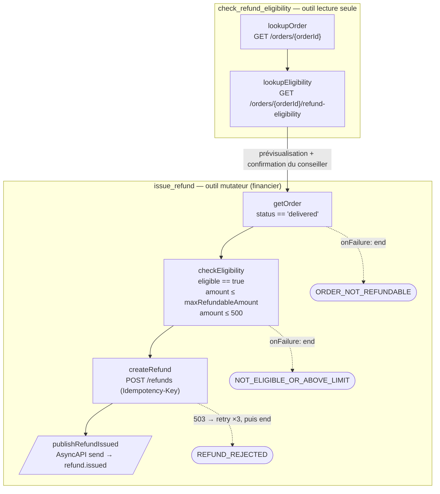

# Agent support : remboursement et événement `refund.issued`

Exemple Arazzo 1.1.0 n° 2 de ConnEthics. Un copilote de support, intégré au helpdesk, aide un conseiller à traiter les demandes de remboursement. **L'humain dans la boucle est le conseiller.** Les messages et notes des clients sont des **données non fiables**, qui peuvent contenir une injection.

Le workflow `issue_refund` est **hybride** :
1. trois étapes HTTP (OpenAPI) : lecture de la commande, puis décision d'éligibilité, puis création du remboursement ;
2. une étape **AsyncAPI** `channelPath` + `action: send`, qui publie `refund.issued` pour la comptabilité et le CRM.

## Fichiers

| Fichier | Rôle |
|---|---|
| `mcp-support-refund.arazzo.yaml` | Workflows `check_refund_eligibility` (lecture seule) et `issue_refund` (hybride) |
| `openapi.yaml` | Stub OpenAPI 3.1 : `GET /orders/{orderId}`, `GET /orders/{orderId}/refund-eligibility`, `POST /refunds` |
| `asyncapi.yaml` | Stub AsyncAPI 3.0 : canal `refundIssued` (adresse `refund.issued`), opération `sendRefundIssued` (`action: send`), vue émetteur |
| `mcp-tools.json` | Publication MCP au format R3 : deux outils, idempotence réelle, confirmation par le conseiller |
| `inputs.json` | Entrées de démonstration (y compris les entrées masquées `idempotencyKey` et `agentId`) |
| `specmatic/` | Script de copie de travail et fichier d'entrées pour exécuter le `send` avec Specmatic |

## Schéma du flux



## Garde-fous

| Garde-fou | Où | Effet |
|---|---|---|
| Commande livrée | `getOrder.successCriteria` + `onFailure: end` | Rien n'est remboursé sur une commande non livrée. |
| Éligibilité décidée par le SI | `checkEligibility` : `$response.body#/eligible == true` | Le LLM ne décide pas de l'éligibilité. |
| Montant borné deux fois | `$inputs.amount <= $response.body#/maxRefundableAmount` et `$inputs.amount <= 500` | Une note client « rembourse 2 000 € » reste sans effet. |
| Aucune destination libre | `destination: original_payment_method` est une constante du workflow | L'IBAN glissé dans `customerNote` ne peut pas être utilisé. |
| Champ libre jamais exposé | `customerNote` absent des `outputs` | L'agent ne lit pas l'injection (voir l'exemple de réponse de `GET /orders/{orderId}`). |
| Idempotence réelle | `Idempotency-Key` = hachage déterministe des arguments (`binding.hiddenInputs`) | Un double clic ne crée qu'un remboursement, et l'événement porte la même clé. |
| Traçabilité | `agentId` injecté depuis le claim `sub` du conseiller | L'agent ne peut pas usurper un autre conseiller. |

Chaque étape a des `successCriteria`. Un critère non satisfait déclenche `onFailure: end` : le workflow s'arrête, et **aucune étape mutatrice ni aucun événement** n'est exécuté.

## Fonctionnalités Arazzo 1.1 illustrées

- **Source `type: asyncapi`** (§5.8.3) à côté d'une source OpenAPI. Avec deux sources non-`arazzo`, les `operationId` sont qualifiés `$sourceDescriptions.support.…`, ce qui est obligatoire (§5.8.5.1).
- **Étape `channelPath` + `action: send`** (§5.8.5.1) :

  ```yaml
  - stepId: publishRefundIssued
    channelPath: '{$sourceDescriptions.refundEvents.url}#/channels/refundIssued'
    action: send
    parameters:
      - { name: idempotencyKey, in: header, value: $inputs.idempotencyKey }   # en-tête du message
    requestBody:
      payload: { refundId: $steps.createRefund.outputs.refundId, … }          # payload du message
  ```

  Un `send` se termine dès l'émission : Arazzo ne modélise pas l'accusé du broker (§5.8.5.3). L'étape n'a donc pas de `successCriteria`.
- **Sémantique des critères 1.1** (§5.8.11.4) : comparaisons entre une entrée et la réponse, et ET logique entre critères.

### Convention `send` / `receive`

`asyncapi.yaml` est écrit **du point de vue du workflow** : le workflow émet, donc l'opération est `action: send`, comme l'étape Arazzo. C'est aussi la convention d'arazzo-cli. **Specmatic attend l'inverse**, c'est-à-dire l'AsyncAPI du *système testé*, qui reçoit l'événement (`action: receive`). La spec 1.1 ne tranche pas.

## Exécuter

### Partie HTTP : Prism + Respect (open source)

```bash
cd app/public/workflows/mcp-support-refund

npx -y @redocly/cli@2.79.0 lint mcp-support-refund.arazzo.yaml openapi.yaml asyncapi.yaml
npx -y @stoplight/prism-cli@5.16.0 mock -h 127.0.0.1 -p 4013 openapi.yaml &

# Outil lecture seule : 100 % HTTP, doit passer
npx -y @redocly/cli@2.79.0 respect mcp-support-refund.arazzo.yaml -w check_refund_eligibility \
  --server support=http://127.0.0.1:4013 --input "$(cat inputs.json)"

# Outil hybride : les 3 étapes HTTP passent, l'étape send est refusée par Respect (code 1 attendu)
npx -y @redocly/cli@2.79.0 respect mcp-support-refund.arazzo.yaml -w issue_refund \
  --server support=http://127.0.0.1:4013 --input "$(cat inputs.json)"

# Garde-fou : montant > plafond remboursable (89,90) → arrêt à checkEligibility, aucun POST /refunds
npx -y @redocly/cli@2.79.0 respect mcp-support-refund.arazzo.yaml -w issue_refund \
  --server support=http://127.0.0.1:4013 --input "$(jq -c '.amount = 120' inputs.json)"
```

### Étape `send` : Specmatic + Kafka (commercial, essai embarqué)

Specmatic Arazzo (`specmatic/enterprise`) est le seul runner testé qui exécute `send`. La licence d'essai embarquée court jusqu'au 01/01/2028. Six adaptations sont nécessaires, appliquées **sur une copie de travail** par `specmatic/prepare-workcopy.py` (détail dans le script) :
1. retrait de `$self` ;
2. `channelPath` remplacé par `operationId` ;
3. AsyncAPI inversée (vue système testé) ;
4. retrait de l'alternative de sécurité vide ;
5. retrait des critères `$inputs.… <= $response…`, que la validation statique « closed-loop » ne sait pas évaluer ;
6. retrait des `onFailure: end` sans `criteria`.

```bash
docker run -d --name kafka --network host apache/kafka:3.9.1
docker exec kafka /opt/kafka/bin/kafka-topics.sh --bootstrap-server 127.0.0.1:9092 \
  --create --if-not-exists --topic refund.issued
python3 specmatic/prepare-workcopy.py /tmp/refund-specmatic        # nécessite PyYAML
cd /tmp/refund-specmatic
docker run --rm --network host -v "$PWD:/usr/src/app" specmatic/enterprise:1.29.2 \
  test mcp-support-refund.arazzo.yaml --sourceNameToBaseUrl support=http://127.0.0.1:4013
# Vérifier l'événement publié :
docker exec kafka /opt/kafka/bin/kafka-console-consumer.sh --bootstrap-server 127.0.0.1:9092 \
  --topic refund.issued --from-beginning --property print.headers=true --timeout-ms 5000
```

**Ce qu'on attend** : `check_refund_eligibility` est vert sous Respect. `issue_refund` a 3 étapes HTTP vertes sous Respect, puis l'étape `send` est refusée. Le cas plafond s'arrête à `checkEligibility`. Sous Specmatic, les 6 étapes sont vertes, et un message `refund.issued` est présent sur Kafka, avec l'en-tête `idempotencyKey`.

## Résultat observé le 16/11/2026

Respect 2.79.0 + Prism 5.16.0 :

```
check_refund_eligibility : Workflows: 1 passed · Steps: 2 passed · Checks: 8 passed       (code 0)

issue_refund :
✓ GET /orders/{orderId} - step getOrder
✓ GET /orders/{orderId}/refund-eligibility - step checkEligibility
✓ POST /refunds - step createRefund
✗ publishRefundIssued
  Reason: No operation found
Steps: 3 passed, 1 failed, 4 total · Checks: 17 passed, 1 failed                            (code 1)

issue_refund, amount = 120 :
✓ getOrder · ✗ checkEligibility ($inputs.amount <= $response.body#/maxRefundableAmo...)
Steps: 1 passed, 1 failed, 2 total                                                           (code 1)
```

Specmatic Enterprise 1.29.2 + Kafka 3.9.1, copie de travail adaptée :

```
Step 'lookupOrder' … 'lookupEligibility' … 'getOrder' … 'checkEligibility' … 'createRefund' … has SUCCEEDED
[Specmatic Async::Test] Message published successfully on topic 'refund.issued'
Step 'publishRefundIssued' in workflow 'issue_refund' for scenario 'DEFAULT' has SUCCEEDED
Tests run: 6, Successes: 6, Failures: 0, WIP: 0, Errors: 0                                  (code 0)

kafka-console-consumer → idempotencyKey:sha256-7b1d0c-demo  {"refundId":"rfd_5f2c91","orderId":"ORD-20261042","amount":45,"currency":"EUR",…}
```

Sans l'adaptation 2, Specmatic répond `No matching scenario found for channelPath: {$sourceDescriptions.refundEvents.url}#/channels/refundIssued and action: send`.

Validation : 0 erreur au schéma officiel 1.1 et aux règles sémantiques §c (`channelPath` au format `{$sourceDescriptions.<n>.url}#/channels/<clé>`, source `asyncapi`, canal existant, `action` réservée à l'étape AsyncAPI). `redocly lint` : 0 erreur, et un seul avertissement, `security-defined`, sur l'opération AsyncAPI du stub. `mcp-tools.json` : 0 erreur au contrôle MCP001–MCP007.

## Limites

- **Aucun runner open source n'exécute `action: send`** en novembre 2026 :
  - Respect le refuse (`No operation found` avec `channelPath`, « AsyncAPI not supported » avec `operationId`) ;
  - arazzo-cli 0.9.0 refuse `send`, en citant OAI/Arazzo-Specification#617 ;
  - Jentic et @usearazzo ne gèrent pas AsyncAPI.

  La voie open source se limite à **valider** le document (`redocly lint`, schéma 1.1) et à exécuter la partie HTTP.
- **Specmatic** est commercial, et son support de `channelPath` est incomplet en 1.29.2 (seul `operationId` est résolu).
- **Doublon possible** : si le service de remboursement publie déjà `refund.issued` (pattern *outbox*), l'étape `send` crée un doublon. L'exemple est pédagogique ; en production, l'événement doit avoir **une seule** source.
- **Le succès du `send` dépend du runner** : la spec ne modélise pas l'acquittement du broker.
