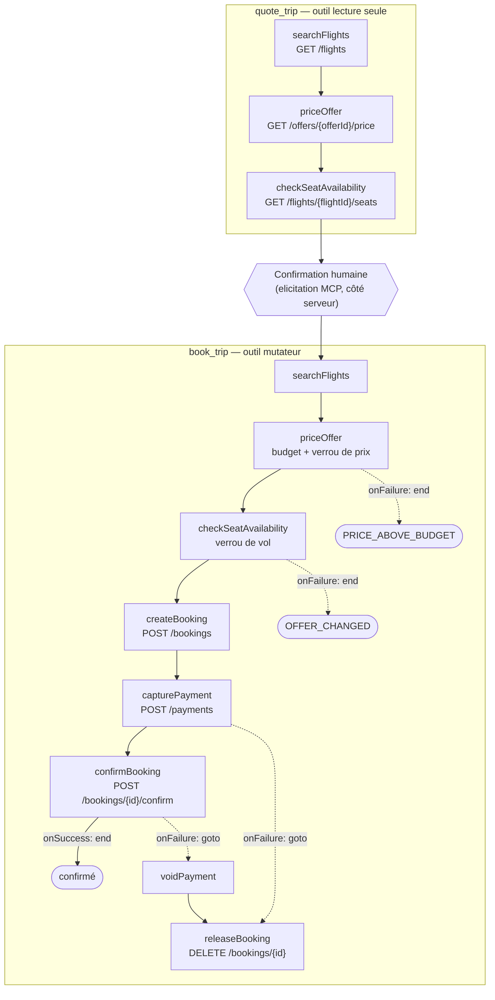
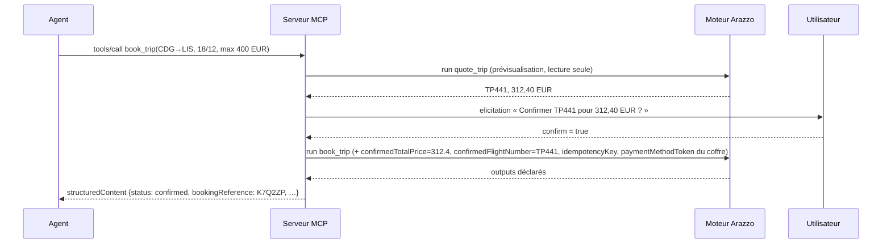

# Réservation de voyage exposée en outils MCP

Exemple Arazzo 1.1.0 n° 1 de ConnEthics. Un assistant de voyage d'entreprise reçoit la demande :

> « Trouve-moi un vol Paris → Lisbonne le 18 décembre, moins de 400 €, et réserve-le. »

L'agent ne compose pas lui-même six à huit appels d'API. Il dispose de **deux outils MCP**, chacun adossé à un workflow Arazzo :

| Outil MCP | Workflow Arazzo | Nature | Étapes |
|---|---|---|---|
| `quote_trip` | `quote_trip` | lecture seule | `searchFlights` → `priceOffer` → `checkSeatAvailability` |
| `book_trip` | `book_trip` | mutateur, effet financier | `searchFlights` → `priceOffer` → `checkSeatAvailability` → `createBooking` → `capturePayment` → `confirmBooking` (+ compensations `voidPayment`, `releaseBooking`) |

## Fichiers

| Fichier | Rôle |
|---|---|
| `mcp-travel-booking.arazzo.yaml` | Les deux workflows (`arazzo: 1.1.0`, `$self`) |
| `openapi.yaml` | Stub OpenAPI 3.1 (vols, réservations, paiements) avec des `examples` alignés pour Prism |
| `mcp-tools.json` | Publication MCP au format R3 : `tool` (servi tel quel dans `tools/list`) et `binding` (côté serveur uniquement) |
| `inputs.json` | Entrées de démonstration pour Respect, y compris les entrées masquées que le serveur MCP injecterait |

## Schéma du flux



Les étapes `searchFlights`, `createBooking` et `capturePayment` réutilisent la failure action `retryWhenBusy` (`components.failureActions`), qui rejoue l'étape sur un `503`, deux fois au plus, toutes les 2 s.

## Le pattern « un workflow = un outil MCP »

Le workflow Arazzo est l'**unité d'intention** exposée à l'agent. Le serveur MCP de ConnEthics lit `mcp-tools.json` et applique la correspondance du lot R3 :

| Arazzo | MCP | Dans cet exemple |
|---|---|---|
| `workflowId` | `tool.name` | `quote_trip`, `book_trip` |
| `summary` / `description` | `tool.title` / `tool.description` | La description de `book_trip` annonce l'effet financier, la confirmation et l'interdiction de demander un numéro de carte. |
| `inputs` moins les entrées masquées | `tool.inputSchema` | `paymentMethodToken`, `idempotencyKey`, `passengerCount`, `confirmedTotalPrice` et `confirmedFlightNumber` ne sont **jamais** visibles de l'agent. |
| `outputs` | `structuredContent` + `outputSchema` | Liste blanche : seules les sorties déclarées remontent. `status`, `correlationId` et `error` sont ajoutés par le serveur. |
| `successCriteria`, `onFailure` | `isError` + `error.code` | `priceOffer` en échec → `PRICE_ABOVE_BUDGET`, sans débit. Les retries s'exécutent dans le moteur, sans aller-retour LLM. |
| Méthodes HTTP résolues dans l'OpenAPI | `annotations` | `quote_trip` : uniquement des `GET`, donc `readOnlyHint: true`. `book_trip` : `POST`, `DELETE` et `sideEffect: financial`, donc `destructiveHint: true`. |

Le choix d'exposition est porté par l'extension `x-connethics-mcp` sur chaque workflow (opt-in, entrées masquées, confirmation, effets de bord). Le préfixe `x-connethics-` n'est pas réservé, contrairement à `x-oai-`, `x-oas-` et `x-arazzo`.

### Confirmation humaine entre `quote_trip` et `book_trip`

Arazzo 1.1 ne sait pas suspendre un workflow pour attendre un humain : l'*actor-in-the-loop* est prévu pour la 1.2. La confirmation est donc portée par le **serveur MCP** (`binding.confirmation`) :



Le prix et le vol confirmés deviennent des **entrées verrouillées**. `book_trip` les revérifie dans ses `successCriteria` (`priceOffer`, `checkSeatAvailability`) : si le prix a monté ou si le vol a changé entre la confirmation et l'exécution, rien n'est débité.

## Fonctionnalités Arazzo 1.1 illustrées

- `arazzo: 1.1.0` et `$self` (§5.8.1.1) : l'identité du document, reprise dans `mcp-tools.json` (`generatedFrom.self`).
- Sémantique des critères `simple` formalisée en 1.1 (§5.8.11.4) : comparaisons entre deux expressions (`$response.body#/total/amount <= $inputs.confirmedTotalPrice`), ET logique entre critères.
- Failure action réutilisable via `reference: $components.failureActions.retryWhenBusy` (forme formalisée par l'ABNF 1.1, §5.9).
- Volontairement **absents** : Selector Object et critères JSONPath. Ils ne sont pas évalués par Respect 2.79 (faux positif silencieux), or cet exemple doit tourner avec Respect. Voir `e2e-order-to-cash`.

## Exécuter (mock Prism + runner Respect)

Versions épinglées (recette R4) : Prism **5.16.0**, Redocly CLI **2.79.0**, Node 22.

```bash
cd app/public/workflows/mcp-travel-booking

# 1. Lint (schéma Arazzo 1.1 choisi d'après le champ `arazzo`)
npx -y @redocly/cli@2.79.0 lint mcp-travel-booking.arazzo.yaml openapi.yaml

# 2. Mock : Prism sert les `examples` de l'OpenAPI
npx -y @stoplight/prism-cli@5.16.0 mock -h 127.0.0.1 -p 4010 openapi.yaml &

# 3. Runner : les deux workflows
npx -y @redocly/cli@2.79.0 respect mcp-travel-booking.arazzo.yaml \
  --server travel=http://127.0.0.1:4010 \
  --input "$(cat inputs.json)" \
  --json-output respect.json

# 4. Cas négatif : budget insuffisant → arrêt à priceOffer, aucun paiement (code retour 1 attendu)
npx -y @redocly/cli@2.79.0 respect mcp-travel-booking.arazzo.yaml -w book_trip \
  --server travel=http://127.0.0.1:4010 \
  --input "$(jq -c '.maxTotalAmount = 300' inputs.json)"
```

En CI, le rapport JUnit se produit avec `../ci/respect-to-junit.mjs` (voir `../ci/arazzo-e2e.yml.example`).

**Ce qu'on attend** : les deux workflows passent. `book_trip` produit `bookingReference: K7Q2ZP`, `paymentStatus: captured` et `totalPrice: {amount: 312.4, currency: EUR}`. Le cas négatif s'arrête à `priceOffer`, sans `createBooking` ni `capturePayment`.

## Résultat observé le 16/11/2026

Prism 5.16.0 + Respect 2.79.0, Node 22.23 :

```
✓ GET /flights - step searchFlights            (quote_trip, puis book_trip)
✓ GET /offers/{offerId}/price - step priceOffer
✓ GET /flights/{flightId}/seats - step checkSeatAvailability
✓ POST /bookings - step createBooking
✓ POST /payments - step capturePayment
✓ POST /bookings/{bookingId}/confirm - step confirmBooking
Workflows: 2 passed, 2 total
Steps: 9 passed, 9 total
Checks: 46 passed, 46 total
Time: 407ms                                    (code retour 0)
```

Cas négatif (`maxTotalAmount: 300`) :

```
✓ GET /flights - step searchFlights
✗ GET /offers/{offerId}/price - step priceOffer
  ✗ success criteria check - $response.body#/total/amount <= $inputs.maxTotalAm...
Workflows: 1 failed, 1 total
Steps: 1 passed, 1 failed, 2 total
Checks: 10 passed, 1 failed, 11 total          (code retour 1)
```

Contre-épreuve avec un second runner, **arazzo-cli 0.9.0** (construit depuis les sources) : `quote_trip` et `book_trip` renvoient `kind: success`, avec les mêmes sorties (`bookingReference: K7Q2ZP`, `seats: [12A]`). arazzo-cli résout les `url` relatives contre `$self` (§5.6.1). Il faut donc l'exécuter sur une copie de travail sans `$self`, avec `servers[0].url` pointé vers Prism (il n'a pas d'option `--server`).

Validation : 0 erreur au schéma officiel 1.1 (`jsonschema`, Draft 2020-12), 0 erreur sémantique (règles §c de R1), `redocly lint` sans erreur ni avertissement sur l'Arazzo et l'OpenAPI. `mcp-tools.json` : 0 erreur au contrôle MCP001–MCP007 (méta-schéma 2020-12 des `inputSchema`/`outputSchema`, union entrées visibles + masquées = `inputs`, méthodes cohérentes avec l'OpenAPI, `digest` à jour).

## Limites

- **Le mock est sans état** : Prism renvoie toujours le premier exemple. Les compensations (`voidPayment`, `releaseBooking`) et les retries `503` sont décrits, mais pas exercés par ce mock. Il faudrait un mock à scénarios (Prism `Prefer: code=…`, Microcks, ou un vrai bac à sable).
- **Fin après compensation** : pour Arazzo, c'est une fin « normale ». C'est le `binding.errors` (`on: executed`) qui la traduit en `isError: true` et `failed_compensated`.
- **SCA / 3-D Secure (`402`)** : le workflow ne peut pas attendre l'utilisateur. Il libère la réservation et renvoie `PAYMENT_ACTION_REQUIRED`. Dans `binding.errors`, cette règle `response` précède la règle `successCriteria`, car la première règle qui correspond l'emporte.
- **`digest`** : c'est le SHA-256 hexadécimal du fichier `.arazzo.yaml`. Toute modification du workflow impose de régénérer `mcp-tools.json` (règle MCP007).
- **Faux avertissement Redocly** : la règle `outputs-defined` de Redocly 2.79 mélange les `stepId` de même nom entre deux workflows. Les sorties de `priceOffer` sont donc alignées dans les deux workflows pour l'éviter.
